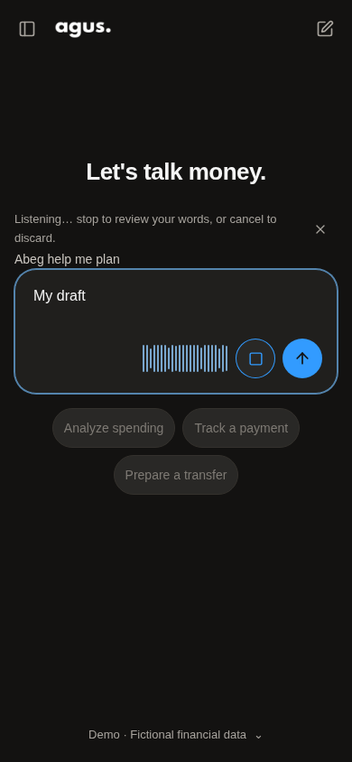

# AGUS conversation and voice reconstruction — October 20, 2026

AGUS’s model connection was working, but the application often prevented the model from using ordinary meaning and context. The v1.2 agent had useful, genuinely agentic read tools surrounded by a brittle command grammar, conflicting shared instructions and restrictive response validation. The repair retains those tools and the payment engine, and changes the interpretation, calculation, memory and communication boundaries.

This is a draft implementation. Automated evidence uses mocked model responses and fictional financial records. **Genuine Gemini behavior, physical microphones and speech-recognition accuracy remain unverified.** The new live evaluation records `MODEL_NOT_CONFIGURED`, with zero genuine provider calls, in [live-evaluation.json](live-evaluation.json). Do not treat deterministic test success as a live quality verdict.

## Baseline and scope

- Initial workspace/main/Gerald: `292d0b192c8be60589d92fe08dc80a8e25c1d7c5`. This is older than the requested integrated implementation; changing it directly would have missed the active financial agent.
- Repair baseline: `origin/integration/agus-v1-2-candidate-20261019` at `5fc0eac18b8120eaa3457f855d4f153c4264350e`. All source references below refer to this exact commit where marked “before.”
- Remote deployment ref: `deploy/agus-render-fixture-20261020` at `5f481dad73c737b58c7db819ec7692ecf90aeaa6`. Its only difference from the candidate is `scripts/render-preview-start.mjs`; application source is identical. No Railway-named branch was exposed by the remote. The actual Railway service’s configured branch/commit was not independently observable here; no Railway settings, live credentials or deployment branches were changed.
- Isolated branch: `repair/agus-agent-reconstruction-20261020`. The repair PR is stacked against the candidate so reviewers see only this repair. Candidate PR #29 and the deployment branch remain unchanged.
- Authentication, origin enforcement, financial-data tools/repositories/permissions, payment approval/execution, Paystack and reconciliation code are unchanged. `intelligence.ts` changes only the audio-transcription prompt. There are no new dependencies, migrations, provider integrations or visual redesigns.

## Root causes with code evidence

| Finding | Evidence in baseline | Consequence and repair |
| --- | --- | --- |
| A natural-language parser was effectively second-guessing the language model. | [`reasoning.ts`, before](https://github.com/omnmlr/hackaholics-financial-agent/blob/5fc0eac18b8120eaa3457f855d4f153c4264350e/src/lib/financial-agent/reasoning.ts#L103) rejects any `actually`, `instead`, `change`, `replace` or similar correction. Lines 199–209 require explicit currency and narrowly placed `save/saving/savings` roles. | The reported “If i **saved** 10,000 naira every month…” does not match the monthly-savings role. Correct model operands can be rejected. Source-linked numeric inputs replace this grammar for the configured model’s new protocol. |
| Financial reasoning received almost no conversational memory. | [`calculationContext()`, before](https://github.com/omnmlr/hackaholics-financial-agent/blob/5fc0eac18b8120eaa3457f855d4f153c4264350e/src/lib/financial-agent/reasoning.ts#L247) admits only one preceding user statement, and only for explicit phrases such as “using those figures.” `agent.ts:404` passes only that context to reasoning. | Pidgin follow-ups, indirect references, changed assumptions and answers to clarification questions lose their meaning. The model now sees bounded, scrubbed dialogue and separately indexed user statements. |
| Rejected calculations vanished from model memory even though they appeared in saved display history. | [`agent.ts`, before](https://github.com/omnmlr/hackaholics-financial-agent/blob/5fc0eac18b8120eaa3457f855d4f153c4264350e/src/lib/financial-agent/agent.ts#L756) returns the broad calculation clarification directly from `catch`, outside `finish()` and context CAS. | The next turn can have no memory of the failed question. Calculation clarifications now persist the request and safe clarification. This directly addresses the reported broken continuity. |
| Lexical routing and prose checks overruled valid semantic decisions. | [`agent.ts`, before](https://github.com/omnmlr/hackaholics-financial-agent/blob/5fc0eac18b8120eaa3457f855d4f153c4264350e/src/lib/financial-agent/agent.ts#L354) sends any general message mentioning AGUS to product selection, then redirects financial vocabulary to education/reads. Line 468 rejects financial words in general prose. | “Hey AGUS, today don tire me” can become a product answer; supportive money-related conversation can be rejected. These broad overrides are removed. Narrow record/action backstops and independent output review remain. |
| Financial narration was a sentence whitelist. | [`narration.ts`, before](https://github.com/omnmlr/hackaholics-financial-agent/blob/5fc0eac18b8120eaa3457f855d4f153c4264350e/src/lib/financial-agent/narration.ts#L121) creates regular-expression sentences; `acceptNarration()` requires every clause to match. | Even correct Pidgin or unfamiliar phrasing falls back to a fixed factual summary. Existing proven sentences retain their deterministic fast path; unfamiliar structured narration can pass an additional semantic support review. Values, citations and disclosures remain backend-owned. |
| Every model task received the same long, partly conflicting policy. | [`model.ts`, before](https://github.com/omnmlr/hackaholics-financial-agent/blob/5fc0eac18b8120eaa3457f855d4f153c4264350e/src/lib/financial-agent/model.ts#L26) mixes route, teaching, advice, calculation, narration and review rules in one system instruction. | Irrelevant restrictions burden every task. A shared authority boundary plus task-specific instructions now give each call one clear job. |
| Dialogue expired along with short-lived financial authority, while the visible chat remained saved. | `financial-integration/conversation.ts` supplies only the 15-minute context store; `chat-history/store.ts` stores a separate display transcript. | A reopened conversation can look continuous while the model starts afresh. The authenticated owner’s recent dialogue can now seed missing context. Financial responses are replaced by markers; selections, permissions and tool facts are never reconstructed from display history. |
| Product knowledge described an already-integrated application as an isolated module needing integration. | `knowledge.ts` overview, version `agus-product-v1.0.0`. | Capability answers were confidently outdated. The reviewed manifest now describes the current integrated scope. |

The protected read loop itself is valuable: it checks ownership and consent, rechecks versions before disclosure, requires current transaction details before evidence, tracks source provenance, and bounds tools, bytes and time. Replacing it with unrestricted model tools would be an architectural regression.

## Chosen architecture

The model interprets and communicates; the server controls authority and exact results.

1. Authenticate the session and bind its principal server-side. Load scrubbed, bounded dialogue. Classify the current goal in context. Ordinary conversation, financial teaching and hypothetical planning do not require an account.
2. For hypothetical calculations, the model chooses a typed recipe or a bounded sequence of arithmetic operations. Every input names an exact numeric quote in an indexed **user** statement and its source unit. There is no JavaScript, SQL, network tool, `eval`, arbitrary expression execution or bank access in this calculator.
3. The backend validates quotes, input coverage, units, ranges and references, then computes using BigInt/rational arithmetic. It rounds only for display and rounds savings-goal months upward. The only implicit operand is zero starting savings for a savings goal, which the server always discloses.
4. The model receives the computed result and writes natural language using immutable value slots. A separate review call checks input roles, corrections, negation, currencies, periods, omitted constraints, formula meaning and final wording. The backend inserts its values and appends its assumptions. The sample question computes **100 months: 8 years and 4 months**, assuming zero starting savings and no interest.
5. Actual financial reads continue through the existing scoped tool loop. Current facts carry source, mode, timestamp, coverage and result IDs. Familiar narration has its existing deterministic proof path. Flexible narration must pass structural/value checks and a separate support review. Missing qualifications and fictional-data disclosure are appended by the server. On rejection, authoritative factual results still display.
6. Payment preparation only hands off to editable, unverified cards. Verification, password reauthentication, immutable approval snapshots, separate submission, OTP, idempotency and reconciliation stay in the existing backend. No model tool can approve or execute a transfer.

The new implementation is in `financial-agent/instructions.ts`, `calculator.ts`, `agent.ts`, `narration.ts`, and the owner-scoped conversation integration. Older server model integrations can still use the original tightly validated calculation format; the configured model is instructed to use source bindings. The retired payment dashboard’s limited parser is unchanged.

A numeric quote proves where a value came from; it does **not** deterministically prove its semantic role. Semantic model review is a fallible additional gate, not a mathematical proof. This is an intentional distinction: natural-language interpretation needs model judgment, while account permissions, payment authority and arithmetic stay deterministic. Free financial prose remains a residual hallucination risk and needs genuine-model adversarial review. Backend fact cards and source disclosures remain authoritative.

Alternatives considered: adding more grammar/phrase rules would reproduce the failure; a free-text model with unrestricted bank tools would weaken authority; replacing the entire read/payment stack would risk reviewed safety work; a multi-agent planner/memory framework would add dependencies and latency without fixing the observed boundary errors. The retained small tool loop plus contextual interpretation and exact calculator is the practical choice before finals.

## Voice findings and implementation

The additional diagnosis was correct. In baseline `use-voice-input.ts`, native recognition returns before the MediaRecorder block. `onresult` only assigns `finalTranscript`; an analyser exists solely in the fallback block at line 429. Native Chrome therefore gets a status pulse instead of measured microphone bars, and live words are not shown. The persistent `<details><summary>About voice</summary>` lives directly beneath the composer. The fallback also stops after just 1.4 seconds of detected silence, which can cut off a natural pause.

The repair provides:

- Native recognition plus a separately permissioned local `getUserMedia` stream for real metering. Web Speech does not expose its own stream. The analyser has no audio-output connection, does not upload its samples, and drives 24 bars from time-domain RMS buckets. MediaRecorder reuses its existing capture stream. When measurement fails, AGUS says the level is unavailable instead of animating fake bars.
- A live transcript preview for native interim results. Typed text remains protected during capture. Stop appends the transcript for editing and explicit Send; Cancel discards pending input. Fallback recording transcribes after Stop.
- Explicit stop/cancel, a one-minute capture cap on both paths, and cleanup on stop, errors, cancellation, hidden page, navigation and unmount. Late permission grants stop their tracks; late callbacks/transcripts cannot populate another chat. A bounded native finish timeout prevents a missing browser `onend` from locking the composer indefinitely. Natural pauses no longer stop fallback recording automatically.
- A **Voice settings** dialog in the sidebar, containing recognition language, privacy/processing details and an opt-in **Read new replies aloud** setting. The persistent About voice element is removed. The default recognition locale is English (Nigeria), with UK/US alternatives. Provider transcription prompts retain Nigerian Pidgin and mixed speech verbatim, without translating or inventing details.
- Existing per-response Listen controls, improved naira pronunciation, available English voice selection, and playback of the visible financial explanation/values/limitations rather than the hidden technical source dump. Playback stops when starting capture or leaving the page. Automatic spoken replies are session-only and cannot start a microphone, send a message or authorize a payment.



This screenshot uses a synthetic microphone, not a physical speaker. [Machine-readable voice evidence](voice/results.json) states the exact test doubles.

### Real-time voice decision

Dictation plus spoken replies is useful turn-taking, but it is not a streaming voice agent. The current stack sends a whole chat request and performs several bounded model calls; fallback audio uploads only after Stop. There is no streaming audio session, incremental model audio, barge-in protocol or live-provider credential/session setup. No model credential or budget configuration was available to measure genuine latency or cost.

The reliable option implemented here is explicit microphone → preview → Stop → review/edit → Send → optional spoken answer. A Gemini Live or other real-time voice integration would require session authentication, a secure audio transport, interruption handling, provider-specific cost/rate assessment and a fresh payment-boundary review. Introducing that experiment before finals would risk the working core. No low-latency or full-duplex claim is made.

## Validation and acceptance

Final automated result: **1,080 tests in 44 files pass**, along with typecheck, lint, production build and authenticated HTTP payment smoke. Production browser journeys pass at 1440, 820, 390 and 320 pixels, with both native and fallback voice submission/lifecycle paths at each size. The final synthetic-microphone harness passes eight real-Web-Audio/control groups, including opting out of spoken playback during an in-flight response. The authenticated HTTP regression also covers the exact reported exchange and a correction after SQL context expiry.

See [verification.txt](verification.txt) for commands and recorded results, [browser-results.json](browser-results.json) for the production journey, and [voice/results.json](voice/results.json) for real Web Audio checks. The reconstruction regressions cover the reported failure, indirect Pidgin follow-up, changed monthly savings, varied unseen values, malformed/unsourced inputs, stale corrections rejected by review, arithmetic, expiry recovery, natural financial conversation and flexible narration. Both Gemini and OpenAI wire adapters are exercised with mocked HTTP. Existing ownership, consent revocation, result correlation, concurrent context, persistence, payment and reconciliation tests remain active.

Run reproducibly:

```sh
npm ci
npm test
npm run typecheck
npm run lint
npm run build
npm run test:http
npm run test:browser
```

For genuine inference, privately configure `AI_PROVIDER=gemini`, an available `AI_MODEL`, and a legitimate `AI_API_KEY` in `.env.local`; keep `PAYMENT_MODE=fixture`. In a managed environment, permit `generativelanguage.googleapis.com` through its supported network configuration and retain proxy/CA settings. Never paste credentials into a chat. Then run:

```sh
NODE_USE_ENV_PROXY=1 npm run evaluate:agent -- /tmp/agus-live-evaluation.json
```

The runner makes actual model requests against fictional read tools, has no payment execution import/capability, caps calls at 85, and spaces them five seconds apart. It runs 17 scenarios across ordinary conversation, the reported exchange, corrections, Pidgin, savings, interest, arithmetic, education, missing inputs, scoped reads, unauthorized accounts and payment boundaries. It saves synthetic question/answer text and latency for human review. `STRUCTURAL_PASS_HUMAN_REVIEW_REQUIRED` is not a quality certification. Review tone, directness, context continuity, role/unit interpretation, clear assumptions and whether clarifications were necessary. Add fresh paraphrases and changed figures; do not tune the code to the evaluation wording. Reject the candidate if any actual-data or action claim lacks current backend evidence.

Physical-device acceptance still required, using desktop Chrome and Android Chrome (and Safari if available), on HTTPS:

1. Allow the mic, speak at different volumes and include silence. Confirm real bars, live interim text where supported, no audio feedback and no clipping of natural pauses.
2. Dictate the same English and Pidgin passages, including names, `₦10,000`, `₦25,000`, decimals and account digits. Manually compare the transcript with what was spoken; record word/entity errors. Never use a real account in the test. No recognition-accuracy result is claimed here.
3. Test permission denial, disconnected/unavailable device, Stop, Cancel, browser auto-end and a one-minute recording. Confirm the browser microphone indicator turns off, drafts remain editable, and no message was sent automatically.
4. Cancel while permission/transcription is pending; navigate, background the tab, switch chats and sign out. Confirm no late transcript edits, stray playback or microphone use.
5. Enable spoken replies, explicitly send a reviewed question and hear the answer. Test Listen/Stop, unavailable voices and interrupted playback. Starting capture must stop playback; receiving a reply must never open the microphone. Recheck payment review/approval remains explicit.

## Remaining limits and release gate

- **Live Gemini behavior and physical audio are release blockers for claiming the conversation/voice experience is proven.** The current environment has no model credential. Its startup network policy does not include Gemini. No provider/network restriction was bypassed and no credential or deployment setting was changed.
- The semantic reviewer uses another bounded call to the configured model, not an independent provider or an infallible verifier. It can share model biases and must be evaluated adversarially. Free prose cannot receive the same deterministic truth guarantee as a rendered financial fact.
- Several calls per turn add latency/cost. Existing limits remain six model calls, five read tools and a 60-second turn deadline; complex reads may use the factual fallback. Actual timings/costs require the live run.
- The numeric normalizer supports bounded decimal/magnitude/number-word notation, NGN recipes and basic arithmetic. Unsupported currencies, negative recipe inputs, ambiguous units, compounding and complex formulas need clarification or future tools. Source/role review must catch unrelated figures and stale corrections.
- Dialogue is bounded to 16 messages/12 KiB with a 4,000-character per-message ceiling. Older dialogue can fall out of context. Expired authority is never revived. A shared operator still shares chat history; this is not a new multi-user banking identity system.
- Financial records remain explicitly fictional; financial conversation remains fixture-gated. No new Wema/Mono or real personal-bank connection is supplied. The deployment startup script and actual Railway configuration require the operator’s separate review before any eventual deployment.
- Browser Web Speech may use an external speech service. Its Pidgin support, native/fallback device sharing, locale handling and privacy vary. Browser TTS quality/autoplay and physical phone behavior remain unverified. Cancellation prevents a late transcript from entering AGUS; it cannot recall audio already sent to a transcription provider. The server’s existing transcription request can continue until its timeout after a client cancel.
- Legacy calculation-format and retired dashboard paths remain for compatibility; they retain their intentionally limited behavior. The new configured-model protocol is the repaired conversation path.

No merge, deployment, Railway change, live account access or real-money transfer is part of this repair. Keep the PR draft pending genuine-model and physical-device acceptance.

## Judge explanation

AGUS uses a language model to understand a person’s words and continue the conversation. It chooses between talking, calculating, retrieving permitted records and preparing a draft. A deterministic backend checks permissions, computes the numbers and owns every financial action. The model explains those results naturally using server-controlled values. Payments still require the person to review, authenticate, approve and submit separately. Voice is another explicit input/output interface to the same protected agent, never a separate authorization channel.
