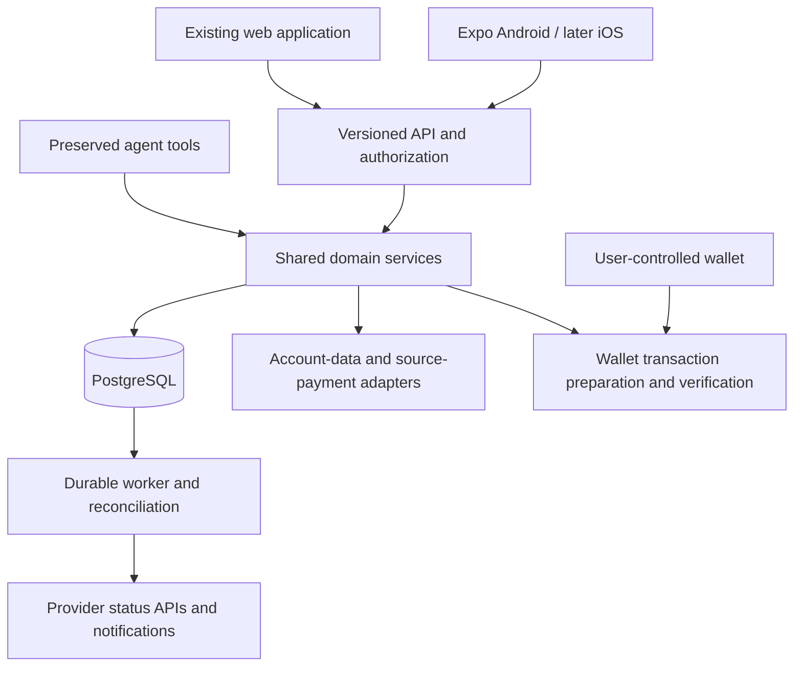

# AGUS 2.0 — Pre-design engineering foundation

## 1. Recommendation and evidence-backed assessment

**Use `dev/agus2-agent-engine-20261109` at `3f767d1` as the proposed integration baseline. First demonstrate a genuine wallet-signed, on-chain-confirmed Solana Devnet transfer. Then complete shared identity, persistence, API contracts, banking/payment foundations, and the Android prototype.**

Target an **internal Android prototype before 27 November 2026**. Implement P2P marketplace contracts and Devnet escrow afterward, within this engineering phase. iOS parity follows Android. Live banking, USD receiving, conversion, and NGN settlement remain external integration gates because no approved partner relationship exists.

Codex owns backend architecture, banking, Solana, P2P, and integration. Antigravity may implement explicitly assigned mobile, testing, and supporting modules in separate branches/worktrees. Its work requires Codex review before integration.

### Repository findings

The investigation covered the remote branch inventory, open PRs, relevant branch ancestry, implementation files, research, historical evidence, and independent checks of the principal candidate branches.

| Component or branch | Finding | Recommended disposition |
|---|---|---|
| `main` / local `work`, `292d0b1` | Older single-operator Next.js/PostgreSQL financial prototype. Substantial later work is absent. | Preserve; do not use as the implementation baseline. |
| `dev/agus2-solana-core-20261109`, `4e378f4` | Strongest existing Solana implementation: exact-message simulation, human approval, wallet signing, durable submission claims, reconciliation, and persisted follow-ups. | Reuse through its descendant agent-engine branch. |
| `dev/agus2-agent-engine-20261109`, `3f767d1` | Contains the Solana branch plus durable general-agent execution and recovery. Already incorporates the earlier provider-endpoint repair. | Proposed baseline; preserve intelligence behavior without developing it further. |
| `feat/agus2-autonomous-engineering-sprint`, `5c2a995` | Independently adds mobile-browser checks, a second executor, shopping modules, and evaluation scaffolding. | Selective reuse only. Do not merge wholesale. |
| `experiment/agus-consumer-source-authority-2026-11-09`, `144311e` | Most useful consolidated banking research: source authority, Remita admission limitations, and Paystack Index/Zap scope. | Preserve research and conformance evidence; does not supply a working bank connector. |
| `research/agus-2-solana-technical-validation-2026-11-09`, `39e2e51` | Useful public RPC and mint observations; no wallet signing or transfer. Some reconciliation recommendations are unsafe. | Reuse observations after correcting interpretations. |
| `feature/agus-external-actions-opus`, `4f1237f` | Earlier shopping implementation overlaps the autonomous-sprint work. | Preserve; defer integration during this phase. |
| `dev/agus2-browser-observation-20261109` | Points to `869b5b9`; no additional browser implementation at that branch head. | Do not count it as an implemented browser subsystem. |
| Existing release stack | Eleven open PRs were returned, including #28, #29, and #36–#44. Production-recovery work and source branches are not equivalent to `main`. | Preserve existing deployment arrangements; no automatic merge or deployment. |

The agent-engine and autonomous-sprint branches diverge from `4e378f4`, with **two and seven unique commits respectively**. Their changes have no overlapping file paths relative to that base. That reduces textual conflict risk, but **does not resolve the architectural conflict between two executors**.

Sources: [Solana checkpoint](https://github.com/omnmlr/hackaholics-financial-agent/blob/4e378f4/docs/agus-2/IMPLEMENTATION.md), [agent-engine checkpoint](https://github.com/omnmlr/hackaholics-financial-agent/blob/3f767d1/docs/agus-2/ENGINE_CHECKPOINT.md), [Antigravity handoff](https://github.com/omnmlr/hackaholics-financial-agent/blob/5c2a995/CODEX_HANDOFF.md), [banking experiments](https://github.com/omnmlr/hackaholics-financial-agent/blob/144311e/experiments/consumer-source-20261109/README.md), [PR #44](https://github.com/omnmlr/hackaholics-financial-agent/pull/44).

### Independent verification performed during planning

Checks ran against temporary snapshots. The original application checkout and inspected source files remain unchanged.

| Check | Observed result |
|---|---|
| Agent-engine tests | Initial run: 1,375 passed; 11 subprocess/local-server checks failed under sandbox restrictions. Those exact 11 passed when rerun with the necessary permissions. All 1,386 existing tests were therefore verified across those runs. |
| Agent-engine TypeScript and lint | Passed. |
| Agent-engine production build | Passed after resolving the subprocess execution restriction. |
| Existing payment HTTP smoke | Passed: authentication, verification, approval, explicit submission, duplicate rejection, reconciliation, persisted status, and export. All financial operations simulated. |
| Workspace HTTP/Chromium smoke | Passed: task approval, idempotency, memory, cancellation, recovery, mobile-browser routes, and disabled-Devnet boundary. No real wallet signing. |
| Autonomous-sprint additions | 37 targeted tests passed; TypeScript passed; lint failed with **36 errors**. Its full reported suite was not independently rerun. |
| Production dependency advisory lookup | Zero reported production advisories for the inspected lockfile. This is not a security audit. |
| GitHub Actions at the two candidate heads | No workflow runs returned for those exact SHAs. Historical green runs do not establish current-head CI. |
| Genuine public Devnet reads | Three successful read-only RPC calls: genesis, Circle test-USDC mint, and latest blockhash. Mint inspection at finalized slot `520763363` confirmed classic SPL ownership and six decimals. |
| Genuine bank access, wallet signing, transfers, native mobile | Not performed or established during planning. |

### Material weaknesses and regression risks

1. **Authentication remains a shared-operator system.** Some financial records already enforce ownership, but this is not complete consumer identity, device management, or multi-user authorization.

2. **Solana approval bypasses the existing throttled reauthentication path.** Its route directly invokes `checkPassword`. Add persistent approval-attempt throttling before broadening access.
   Evidence: [Solana approval route](https://github.com/omnmlr/hackaholics-financial-agent/blob/3f767d1/src/app/api/agent-workspace/solana/route.ts#L69).

3. **Payment persistence remains a globally contended JSONB aggregate.** Newer workspace and Solana tables improve isolation, but production normalization, indexed reconciliation, migration history, and database-role separation remain necessary.

4. **Runtime schema creation is widespread.** The migration command does not constitute a complete versioned migration system for all current tables.

5. **The autonomous executor is not an acceptable financial execution boundary.**
   - Any nonempty authorization token passes its generic gate.
   - Failed consequential actions can be retried without consulting `isIdempotent`.
   - “Verified” evidence is generated from successful tool return.
   - Its merchant-message adapter returns `dispatched: true` without sending a message.
   - Its checkpoint object is not itself durable database persistence.

   These are integration hazards, not evidence that the currently selected runtime exposes those modules.
   Sources: [registry](https://github.com/omnmlr/hackaholics-financial-agent/blob/5c2a995/src/lib/agent-architecture/tool-registry.ts#L65), [executor](https://github.com/omnmlr/hackaholics-financial-agent/blob/5c2a995/src/lib/agent-architecture/planner.ts#L155), [message adapter](https://github.com/omnmlr/hackaholics-financial-agent/blob/5c2a995/src/lib/external-actions/adapter.ts#L172).

6. **External-fetch hardening is incomplete.** The shopping fetch helper follows redirects and reads an unbounded response body; URL sanitization alone is insufficient SSRF protection. Keep this subsystem outside the financial foundation.

7. **Solana research must not become execution policy unchanged.** A missing transaction from one RPC after blockhash expiry is not sufficient proof of failure. A Solana Pay reference assists discovery; it is not an on-chain exactly-once enforcement mechanism.

8. **Existing mobile evidence is browser evidence.** There is no React Native/Expo application in the inspected candidates.

9. **Several research claims are stronger than their evidence.** Aggregate banking coverage, assumed pricing, “instant” confirmations, and generic RPC failover recommendations require correction before becoming product requirements.

## 2. Capability and integration gap matrix

Labels apply to the stated scope:

- **V — Implemented and independently verified**
- **I — Implemented, not verified end-to-end**
- **S — Simulated**
- **B — Blocked by credentials, partner approval, or regulation**
- **N — Not implemented**

| Capability | Current classification | Required completion |
|---|---|---|
| Single-operator sessions and ownership checks | V within existing prototype | Individual identities, device sessions, recovery, roles, and comprehensive isolation |
| Consumer registration and native authentication | N | Shared web/mobile identity implementation |
| Financial account/consent/history domain | V for fixture behavior; S data | Provider-neutral live-capable storage and adapters |
| Existing personal-bank account linking | N / B | Hosted consent, authorized account discovery, credentials, and bank-specific acceptance |
| Personal-bank balances/history | S; live access B | Real adapter acceptance and freshness/coverage evidence |
| Paystack beneficiary/payout adapter | I; fixture lifecycle V | Account-level provider tests; retain merchant-funded classification |
| Existing-account-to-beneficiary payments | N / B | Authorized source-payment adapter, source-bound approval, reconciliation |
| Payment approval/idempotency/reversal logic | V under fixtures | Normalize persistence and generalize without weakening invariants |
| Devnet balance/mint reads | V at public-RPC scope | Integrate native wallet presentation and operational monitoring |
| SOL/classic SPL preparation and submission pipeline | V under automated tests; I end-to-end | Funded wallet signing and independently confirmed transactions |
| Circle Devnet USDC transfer | I | Canonical mint labeling and genuine funded transfer evidence |
| On-chain wallet history | N beyond saved AGUS drafts | Paginated chain history with explicit coverage limits |
| Payment requests, QR, Solana Pay | N | Request lifecycle, parsing, matching, and payment evidence |
| Jupiter swaps | N | Current API contract; separately gated execution |
| P2P offers, matching, disputes, escrow | N | Marketplace backend and Devnet escrow |
| USD receiving and conversion | N / B | Partner contracts, eligibility, receiving/conversion lifecycle |
| Responsibilities and in-app notifications | V within development implementation | Independent worker, durable deliveries, push integration |
| Native Android/iOS applications | N | Expo foundation and physical-device acceptance |
| Production deployment and recovery | I / incomplete | Managed PostgreSQL validation, migrations, restore, workers, observability, operational ownership |

### Nigerian source-institution coverage

Create **23 candidate institution records**, leaving every operation disabled until its evidence gate passes.

| Candidate group | Institutions |
|---|---|
| Priority payment institutions and digital banks | OPay, PalmPay, Moniepoint, MTN MoMo PSB, Kuda |
| Priority commercial banks | GTBank, Access, Zenith, FirstBank, UBA, Union Bank |
| Remaining priority institutions | Wema/ALAT, FCMB, Fidelity, Sterling, Stanbic IBTC, Ecobank |
| Additional candidates | Jaiz, Providus, Polaris, Keystone, Standard Chartered Nigeria, VFD Microfinance Bank |

**Current independently accepted source connectivity: zero of these institutions.**

Each institution needs separate evidence for linking, account types, balances, history, reauthorization, revocation, and source payments. Maintain legal-entity and provider identifiers; do not count ALAT separately from Wema, or multiple authentication channels as multiple institutions. Recheck institution status and consolidation before counting launch coverage.

Maintain a separate **beneficiary-bank directory** for NIP/payment-provider destinations. Destination reachability never enables a source capability.

### Provider decisions

| Provider/route | Engineering treatment | External gate |
|---|---|---|
| Mono Connect | First documented account-data adapter: hosted connection, server-side code exchange, account information, transactions, reauthorization, synchronization, unlinking | Business/compliance approval, credentials, permitted use, commercial terms, institution-specific coverage |
| Bank-sponsored Open Banking Nigeria interface | Build standards-shaped contracts and local conformance tests | Actual sponsor, registered client, authorization server, certificates, scopes, bank endpoints, and approved operating role |
| Remita consumer-channel partnership | Preserve as a source-payment candidate; implement only against an issued consumer contract | Written third-party consumer delegation and source-account/payment scope |
| Paystack Transfers | Preserve existing payout adapter as a distinct capability | Approved merchant account and transfer access; does not meet personal-source requirement |
| Mono payment products | Separate collection/mandate adapter if eventually approved | Arbitrary-beneficiary consumer payments are not established by collection documentation |
| Paystack Index/Zap | Do not use as a substitute banking backend | Existing research documents Zap-balance funding and unresolved AGUS eligibility/source scope |
| Bridge | Conditional USD receiving/conversion adapter for personal freelance/salary use | Nigerian-resident eligibility, sender rules, KYC, approved product, commercial terms |
| Paycrest | Conditional USDC/NGN settlement partner adapter | Sender approval, compliance allocation, actual Solana liquidity, payout/return evidence |
| Other aggregators/direct institutional APIs | Add through the same capability contracts when documented | No coverage or production-access claims without current evidence |

Mono’s current public guide documents a temporary authorization code exchanged server-side for an account identifier. **That identifier is not a generic OAuth refresh token.** Adapter-specific credential lifecycles must remain explicit. Its aggregate “30+ institutions” statement does not prove AGUS’s named source-bank coverage.

Primary references: [Mono connection guide](https://docs.mono.co/docs/financial-data/integration-guide), [Mono coverage](https://docs.mono.co/docs/coverage), [Mono payment scope](https://docs.mono.co/docs/payments/overview), [CBN open-banking guidelines](https://www.cbn.gov.ng/Out/2023/CCD/Operational%20Guidelines%20for%20Open%20Banking%20in%20Nigeria.pdf), [Bridge country eligibility](https://apidocs.bridge.xyz/platform/customers/compliance/supported-countries-list), [Paycrest supported networks](https://docs.paycrest.io/resources/supported-stablecoins).

## 3. Proposed architecture and critical decisions

### Shared application structure

Retain **TypeScript, Next.js, PostgreSQL, and Drizzle**. Build a modular backend with a separately runnable worker. Do not introduce microservices, Kafka, or an additional database for this phase.

Keep the existing web application in place. Add npm workspaces for the mobile application and shared contracts/client packages.

The agent and manual interfaces call the same services. The agent may read authorized information, prepare instructions, and propose responsibilities. It cannot fabricate approval or bypass provider authorization.

### Public contracts

Publish OpenAPI 3.1 and generated TypeScript clients for `/api/v1`. Shared packages contain schemas and client-safe types, never database code or credentials.

| API family | Required interfaces |
|---|---|
| Identity | Current user, device sessions, revocation, step-up challenges |
| Banking | Institution capabilities, connection sessions/callbacks, consent, source accounts, balances, transactions, synchronization, disconnect |
| Payments | Beneficiary verification, payment preparation/quote, approval, submission, status, receipts, disputes |
| Solana | Wallet association, balances/history, transfer preparation, approval, signed submission, reconciliation |
| Requests | Payment-request creation, lookup, expiry/cancellation, matched settlement |
| Responsibilities | Existing task/memory/run interfaces adapted to the authenticated principal |
| Notifications | Inbox, read state, device registration, preferences |
| P2P | Offers, quotes, reservations/orders, settlement evidence, disputes |
| USD | Eligibility/onboarding requirements, receiving accounts, incoming funds, conversions, returns |

Contract rules:

- Monetary quantities cross the API as **integer atomic-unit strings**, with currency/asset and scale. Preserve existing safe integer-kobo calculations behind compatibility adapters.
- Every financial record identifies provider, environment/network, provenance, observation time, and verification state.
- Mutating financial operations use an idempotency key and canonical request hash. Reusing a key with different instructions returns a conflict.
- Mutable resources expose a revision; stale actions fail explicitly.
- Pagination uses opaque cursors. Incomplete history remains visibly incomplete.
- Errors expose stable codes, retryability, and correlation IDs without raw provider credentials or sensitive payloads.
- Existing web routes become compatibility wrappers over the same services. No independent mobile payment engine.

### Identity, permissions, and secrets

Use **Better Auth with PostgreSQL/Drizzle**, its supported Expo integration, and server-managed sessions. This avoids expanding the operator-password prototype into a custom consumer authentication framework.

- Individual users; separate privileged support/operations roles.
- Web: HttpOnly secure cookies and origin/CSRF protections.
- Native: documented secure session transport and SecureStore; authenticate independently of a client-supplied origin or device ID.
- Reauthentication creates a short-lived, single-use approval bound to the exact instruction digest.
- Use password plus TOTP for initial privileged/financial step-up; bank/provider authentication and wallet signing remain separate requirements.
- Biometrics unlock locally protected credentials. A client boolean saying biometrics succeeded is never sufficient server approval.
- Internal prototype enrollment is invite-only. Production verification/recovery requires a working approved email channel.
- Provider grants and sensitive identifiers use envelope encryption with key versioning. Production key material belongs in a secret manager/KMS; local test keys remain development-only.
- Do not collect bank passwords, PINs, seed phrases, or wallet private keys.

Reference: [Better Auth Expo integration](https://www.better-auth.com/docs/integrations/expo).

### Persistence, jobs, and migration

Normalize users, devices, connections, consents, source accounts, snapshots, transactions, beneficiaries, payment instructions, approvals, execution attempts, provider events, and receipts.

Use PostgreSQL transactional inbox/outbox tables and leased jobs with fencing. External calls happen outside database transactions. Delivery is at least once; handlers must be idempotent.

Replace production runtime DDL with ordered, checksummed migrations under an advisory lock. Application startup checks schema compatibility.

Migration must preserve:

- Existing ownership, references, submitted instruction bytes, signatures, outcomes, and audit history.
- Unknown and pending operations as unresolved.
- Existing fixture records as fixtures.
- Submitted payment authority without recreating submission rights.

Invalidate unconsumed legacy approvals during identity/storage cutover and require a new review. Archive the original aggregate for reconciliation; do not silently discard it or maintain indefinite dual writes.

### Account connectivity

Define separate `AccountDataProvider`, `SourcePaymentProvider`, and `BeneficiaryDirectoryProvider` interfaces.

The account-data lifecycle covers connection initiation, callback completion, source-account discovery, grants, balance/history reads, refresh/reauthorization, health checks, synchronization, and revocation.

Required behavior:

- Provider-hosted authentication.
- Single-use callback state bound to user and connection attempt.
- Capability-specific scopes and expiry.
- Available and ledger balances distinguished.
- Historical snapshots carry freshness and coverage.
- Transaction synchronization uses provider IDs and cursors; corrections/reversals update existing records.
- Local revocation immediately stops new reads/jobs. Provider revocation can remain pending until acknowledged.
- Capability health is operation-specific; a healthy beneficiary directory does not imply healthy account linking.

The realistic test provider must model asynchronous consent, delayed data, partial coverage, expired grants, rate limits, duplicate events, reversals, and outages. It must identify every response as simulated.

### Payments and reconciliation

Reuse the existing approval, submission-claim, webhook, OTP, reversal, and uncertainty protections.

Extend approval binding to include the **source account and grant**, beneficiary identity, amount, currency, fee quote/version, expiry, environment, and instruction revision.

Use a durable lifecycle:

`draft → beneficiary_verified → awaiting_confirmation → authorized → submitting → pending/unknown → succeeded/failed`

Additional outcomes include `expired`, `cancelled`, and `reversed`. Disputes are separate cases linked to the payment.

- API acceptance and webhook delivery are observations, not settlement.
- Persist provider reference and execution claim before submission.
- A timeout after possible submission becomes unknown; reconcile before considering replacement.
- Retry reads with bounded backoff. Retry monetary writes only when the provider’s documented idempotency contract makes that safe.
- Reversals remain observable after earlier success.
- Receipts distinguish provider-confirmed status, bank-credit evidence when available, and simulation.
- No claim of exactly-once execution across independent banking systems.
- Fee/entitlement interfaces are configurable. No Gold/Diamond rules, subscription gates, or unapproved fee policy.

### Solana

Preserve the current transaction service and its SDK boundary. Retain the classic-SPL codec and oracle tests until a separately reviewed replacement demonstrates an advantage.

Essential work:

- Genuine desktop wallet connection and signed SOL/Devnet-USDC transfers.
- Android Mobile Wallet Adapter support.
- Explicit network identity and Circle mint validation.
- Exact-message simulation, approval, signing, and reconciliation.
- Fee/rent checks, wallet changes, rejection, expiry, restart recovery, and uncertainty.
- Paginated transaction history and durable receipts.

Use only configured RPC endpoints with genesis verification, bounded reads, health tracking, and circuit breakers. Read failover must not become automatic cross-provider resubmission.

An expired unsigned transaction requires rebuilding, simulation, and renewed approval. Never silently refresh the blockhash after approval.

Highest-value additions after the first confirmed transfer:

1. Solana Pay transfer requests and QR codes.
2. Request-to-payment matching with exact recipient, mint, amount, network, and reference checks.
3. Reliable pending-payment follow-up and notifications.
4. Native Android signing.

Jupiter is optional after those essentials. Current documentation uses **Swap API v2**, not the old v6 recommendation. Preserve quote expiry, minimum received, fees, program/account validation, and exact signed-message inspection. Do not promise a genuine Jupiter Devnet swap without an actual supported route and liquidity.

Token-2022, cross-chain transfers, staking, compressed assets, and sponsored transactions are deferred.

References: [Circle mint addresses](https://developers.circle.com/stablecoins/usdc-contract-addresses), [Mobile Wallet Adapter platform support](https://docs.solanamobile.com/developers/mobile-wallet-adapter), [current Jupiter API](https://developers.jup.ag/docs/swap).

### Native mobile

Antigravity owns an isolated Expo/React Native application using the shared generated client.

Build infrastructure and functional test harnesses without choosing final navigation, layouts, branding, or visual components.

- SecureStore, device sessions, local biometric unlock, deep-link validation, foreground recovery, and push registration.
- Android development build with Mobile Wallet Adapter; Expo Go is not the acceptance environment.
- No automatic submission when connectivity returns or the app resumes.
- Notifications carry opaque resource identifiers; opening them retrieves authenticated state.
- Later iOS wallet integration uses a separately verified wallet-supported deep-link/universal-link flow. MWA currently does not support iOS.
- Physical-device acceptance is distinct from emulator/browser testing.

### P2P and USD

P2P v1 uses single-counterparty fills with atomic quote reservations. Offers contain available size, limits, rate, expiry, payment method, and trader eligibility. Matching ranks valid quotes deterministically by executable value and then time; no speculative AI matching.

Order lifecycle:

`quoted → reserved → awaiting_escrow → escrow_funded → awaiting_fiat → fiat_claimed → fiat_verified → release_pending → completed`

Expiry, cancellation, dispute, refund, and uncertain settlement remain explicit.

For the Devnet escrow prototype:

- Use an Anchor program with a per-order PDA and an allowlisted test-USDC mint.
- Bind buyer, seller, amount, destination, order digest, and authority configuration.
- Require finalized funding before treating escrow as funded.
- Cooperative release requires seller authorization plus the settlement-verifier authority.
- Mutual cancellation requires both parties; disputed release/refund requires a fixed 2-of-3 arbitration authority.
- Do not allow a clock alone to refund a funded order when fiat may already have moved.
- Keep PII off-chain; store opaque references/hashes only.
- The prototype’s verifier is explicitly simulated. A program cannot independently observe Nigerian bank settlement.

Production release requires authenticated fiat evidence from an authorized partner, independent program review, key governance, and an approved regulatory/liability model. Screenshots and “I paid” buttons cannot release escrow.

USD infrastructure targets **personal freelance/salary receipts for Nigerian residents**. Separate customer eligibility, receiving-account issuance, incoming funds, conversion quotes, blockchain delivery, NGN payout, and returns. Receiving USD is not itself evidence that USDC was delivered.

## 4. Dependency-ordered engineering sprints

The estimates are working ranges, not guaranteed elapsed dates. All acceptance conditions below are mandatory for the stated sprint scope. External capability rows remain blocked until their evidence exists.

### Sprint 0 — Establish the integration baseline and safety gates

**Outcome:** A reproducible, protected foundation for subsequent work.

**Reuse / expected changes:** Baseline `3f767d1`; existing tests and smoke scripts; `.github/workflows/agus2-foundation.yml`, capability evidence manifest, and the Solana approval route/auth helper.

**Tasks**

- Create an isolated integration branch from the pinned baseline after approval.
- Record branch provenance and accepted/deferred changes.
- Add current-branch PR CI with no model or financial credentials.
- Fix persistent Solana approval throttling and add its regression coverage.
- Separate fixture, sandbox, Devnet, and future live configuration validation.
- Record the autonomous executor/message adapter as excluded from runtime integration.

**Acceptance and completion**

- Existing 1,386-test baseline, typecheck, lint, build, HTTP safety, and workspace smoke pass.
- Repeated invalid approval attempts are throttled across process restart.
- Wrong-owner, stale-digest, and expired approval requests fail.
- CI cannot invoke paid models or live payment operations.
- A reviewed baseline/evidence manifest identifies exact SHAs and exclusions.

**Dependencies / parallel work / risks:** No external partner dependency. Approximately one working day. Antigravity may prepare contract-test inventories and mobile dependency reconnaissance in its own branch. It must not edit backend authentication or CI ownership rules.

### Sprint 1 — Prove genuine Solana Devnet execution

**Outcome:** Actual wallet-connected SOL and test-USDC payments with durable on-chain evidence.

**Reuse / expected changes:** `src/lib/solana/*`, `src/components/devnet-wallet.tsx`, Solana route, existing reconciliation/follow-up tests, and a bounded acceptance runner.

**Tasks**

- Preserve the existing pipeline; repair only issues exposed by genuine acceptance.
- Add canonical Circle test-USDC identification.
- Use owner-controlled Devnet wallets funded with faucet assets.
- Complete SOL first, then test-USDC, including destination token-account creation.
- Capture redacted evidence without private keys or wallet session secrets.

**Acceptance and completion**

- User explicitly connects and signs through an actual wallet.
- Suggested acceptance amounts: `0.001` Devnet SOL and `1` test USDC.
- Saved signature resolves to the expected transaction on Devnet.
- Independent RPC retrieval confirms exact sender, recipient, mint/amount, `meta.err = null`, and finalized status.
- Appropriate token/balance changes and network fees reconcile.
- Saved results survive server restart.
- Wallet rejection, account change, stale approval, insufficient fee balance, and expiry cannot produce a false success.
- Duplicate submission causes at most one application broadcast; lost responses remain reconcilable.
- Both real-transfer evidence and fixture-only tests are labeled separately.

**Dependencies / parallel work / risks:** Sprint 0; user-controlled test wallets, faucet availability, and public RPC. Approximately 1–3 working days, subject to wallet access. Antigravity can prepare the Android shell concurrently. **No escrow or advanced swap work precedes this proof.**

### Sprint 2 — Shared identity, versioned API, and durable platform

**Outcome:** A multi-user backend suitable for independent web/native clients.

**Reuse / expected changes:** Existing ownership/consent schemas and stores; `src/lib/auth.ts`, `src/lib/db.ts`, `migrations/*`; new `src/server/`, `packages/contracts/`, `packages/api-client/`, `/api/v1`, and worker entrypoint.

**Tasks**

- Introduce Better Auth, device-session management, roles, and action-bound step-up.
- Publish the shared API and stable client contracts.
- shared API and stable client contracts.
- Normalize payment execution records and introduce a checksummed migration runner.
- Add inbox/outbox, leases, fencing, retries, and dead-letter inspection.
- Add secret encryption, redacted structured logs, request IDs, health/readiness, and job metrics.
- Adapt existing web and agent callers through compatibility wrappers.
- Preserve memory/responsibility behavior without expanding intelligence.

**Acceptance and completion**

- Three users cannot access or mutate one another’s accounts, payments, drafts, tasks, notifications, or receipts.
- Revoking a device invalidates its access; resetting identity credentials revokes applicable sessions.
- Consumed, expired, mismatched, and replayed approval challenges fail.
- Migrations succeed on empty and existing fixture databases; reruns are safe and checksum mismatches stop execution.
- Migration reconciliation preserves identifiers, submitted authority, statuses, and audit records.
- Two PostgreSQL workers cannot execute the same claimed effect.
- Process termination around commit/delivery produces no duplicate logical action.
- Runtime database credentials cannot perform schema migrations.
- Automated log scans find no test secrets, tokens, passwords, or raw sensitive payloads.

**Dependencies / parallel work / risks:** Sprint 0; preserve and rerun Sprint 1 behavior. Approximately 3–5 working days. Antigravity owns generated-client consumption and mobile session tests; Codex owns all schemas, auth, migrations, and worker contracts. Real PostgreSQL testing is mandatory; PGlite alone is insufficient.

### Sprint 3 — Bank connectivity and source-payment foundation

**Outcome:** Complete simulated account-to-beneficiary workflows and real documented adapter contracts, without claiming bank access.

**Reuse / expected changes:** `src/lib/financial-data/*`, existing payment/Paystack logic; new banking/provider/payment modules, migrations, `/api/v1` handlers, and provider conformance tests.

**Tasks**

- Add the 23-candidate registry and separate beneficiary directory.
- Implement the full account-data and source-payment interfaces.
- Build the realistic test provider with configurable failure scenarios.
- Implement Mono’s documented data adapter using injected transport and sanitized contract fixtures.
- Keep unsupported source-payment operations explicitly unavailable.
- Bind source grants and fee quotes into payment approvals.
- Implement durable reconciliation, receipts, disputes, and reversals.
- Add disabled sponsor/Remita integration boundaries without inventing endpoints.

**Acceptance and completion**

- Every candidate institution has individual, operation-specific capability records; all unverified live flags remain false.
- Consented test account linking discovers multiple accounts and persists across restart.
- Wrong-user, expired, and replayed linking callbacks fail.
- Revocation stops new reads and invalidates pending source-payment authority.
- Initial/incremental synchronization handles pagination, duplicates, corrections, partial history, and interrupted jobs.
- One hundred concurrent duplicate submissions result in one execution claim and at most one provider submission.
- Changed payload under an existing idempotency key fails.
- Crash-before-send, crash-after-send, lost response, expired authorization, duplicate/out-of-order webhook, delayed reversal, and provider outage are covered.
- No webhook alone marks a payment successful.
- Simulated receipts remain unmistakably simulated.
- Mono adapter tests conform to the documented wire contract; genuine sandbox acceptance remains a separately blocked gate.

**Dependencies / parallel work / risks:** Sprint 2 contracts and persistence. Approximately 3–5 working days. Antigravity may implement test vectors and client integration tests against frozen contracts. No live partner access is available; that does not prevent completing this sprint’s independent scope.

### Sprint 4 — Android foundation and native integration

**Outcome:** Installable internal Android app using the shared backend and an actual mobile wallet.

**Reuse / expected changes:** Shared contracts/client, existing behavior specifications; new `apps/mobile/`, mobile tests, Android configuration, and approved deep-link associations.

**Tasks**

- Antigravity creates the Expo development-build foundation.
- Implement sessions, secure storage, biometric local unlock, account/transaction retrieval, notifications, and resume/offline behavior.
- Integrate Android Mobile Wallet Adapter through the agreed wallet interface.
- Add functional developer harnesses for banking and transaction states.
- Codex reviews every backend/API change requested by mobile integration.

**Acceptance and completion**

- Install and launch on a physical Android device.
- Authenticate, restart, resume, revoke the session remotely, and confirm access denial.
- Sensitive session material does not appear in ordinary storage, logs, crash output, or deep-link query parameters.
- Wallet connection, rejection, app switching, signing, and return work on a real supported Android wallet.
- At least one Android-originated Devnet transfer reaches verified finality.
- Repeated/deceptive callback links cannot approve or submit.
- App termination after signing/submission recovers the existing instruction.
- Network recovery never silently sends a financial operation.
- Push denial and invalid/expired device tokens are handled; real push delivery is separately evidenced when platform credentials are available.

**Dependencies / parallel work / risks:** Scaffold begins after Sprint 0; session/client integration follows Sprint 2; final acceptance requires Sprints 1 and 3. Approximately 4–6 Antigravity working days, overlapping Codex work. Hardware
