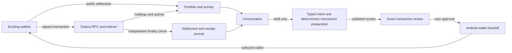

# Recommended technical architecture

## Core path

Use the existing Expo harness and the boundaries in PR #46 as the baseline for a controlled proof of concept. AGUS aggregates all linked and watched accounts, prepares a transaction against one explicitly selected payer and asks that wallet to sign it. Start with SOL and a narrow set of classic SPL transfers. Mainnet stays watch-only while the device signing and settlement evidence is incomplete. Existing wallet connection is sufficient for the core path. [Wallet spike #46](https://github.com/omnmlr/hackaholics-financial-agent/pull/46) · [Journal decisions](https://github.com/omnmlr/hackaholics-financial-agent/blob/87be10e5e9f4606e0c902f67f488a9c8f1823869/docs/agus-crypto/DECISIONS.md)

1. **Account registry and transport.** Key holdings by chain and owner address, with separate signing routes keyed by transport, wallet app identity, chain and authorized address. Deduplicate the same address linked through several routes while keeping those routes selectable. Keep MWA grants in Android secure storage. Preserve wallet endpoint and token rotation when supplied, invalidate on mismatch and distinguish local unlink from wallet-side deauthorization. Prefer the officially supported endpoint association and a maintained wallet-targeting API. Treat PR #46's native package-routing patch as implementation evidence requiring maintenance and device validation. Never silently substitute a different wallet or chain to recover a failed request. A documented vendor link can be a separately tested route with explicit selection. [PR #46 compatibility](https://github.com/omnmlr/hackaholics-financial-agent/blob/4c132b7fb540a8f7b970ec4ff0873aa6ac44df7a/docs/AGUS_WALLET_COMPATIBILITY.md) · [MWA authorization](https://github.com/solana-mobile/mobile-wallet-adapter/blob/main/spec/spec.md#authorize)
2. **Portfolio reads.** Collect SOL and parsed token accounts for both program IDs. Record balance source, cluster, mint, account, decimals, slot and freshness. Deduplicate token accounts and keep unit amounts when valuation is unavailable. Label the total as partial where an RPC, price or position adapter is incomplete. Show source-account spendability separately from aggregated holdings. For example, PR #46 can display tokens outside the canonical ATA while its transfer path uses the canonical ATA. Index history asynchronously and apply user-facing privacy controls to linked address sets. [Solana token-account RPC](https://solana.com/docs/rpc/http/gettokenaccountsbyowner) · [PR #46 balance and preparation source](https://github.com/omnmlr/hackaholics-financial-agent/blob/4c132b7fb540a8f7b970ec4ff0873aa6ac44df7a/apps/mobile/src/solana-control.ts)
3. **Intent and review.** Let the model create a typed draft and ask for missing information. A deterministic adapter resolves chain, signer, recipient, mint, amount in base units and supported instruction family. Build and simulate the message on the intended cluster. Present payer and wallet, destination and any resolved name, mint and amounts, fee payer, fee/rent estimate, relevant warnings, and quote or blockhash expiry. Require a deliberate review action tied to the exact message, intent revision and attempt. Any material change invalidates that review. Treat conversation, uploaded content and tool responses as untrusted inputs. Signing requests originate from the reviewed flow and the model has no access to the wallet grant, signer or raw signing endpoint. [PR #46 transaction preparation](https://github.com/omnmlr/hackaholics-financial-agent/blob/4c132b7fb540a8f7b970ec4ff0873aa6ac44df7a/apps/mobile/src/solana-control.ts) · [Solana transaction structure](https://solana.com/docs/core/transactions/transaction-structure)
4. **Handoff and submission.** Persist an attempt and independent reconciliation reference before opening the wallet. Reauthorize and re-check the exact signer, chain, transaction capability and message validity. Prefer MWA sign-and-send where supported. A separately validated sign-only adapter must check returned message equality and required signatures before it submits. Record a returned signature and distinguish a declined wallet, a definitive chain failure and an unknown outcome. A lost callback or app restart can leave a transaction live. Reconcile first, then allow a newly reviewed replacement only after expiry and enough evidence to rule out an earlier settlement. Use an atomic claim on each attempt and a duplicate guard for concurrent flows. [PR #46 wallet journal source](https://github.com/omnmlr/hackaholics-financial-agent/blob/4c132b7fb540a8f7b970ec4ff0873aa6ac44df7a/apps/mobile/src/wallet-control.ts) · [MWA submission semantics](https://github.com/solana-mobile/mobile-wallet-adapter/blob/main/spec/spec.md#sign_and_send_transactions)
5. **Settlement.** Verify expected cluster, signature or reference, exact message, intended signers and execution outcome independently through RPC. For an operation with dynamic execution effects, verify the expected balance or program outcome too. Distinguish pending, finalized success, finalized error, mismatch and expired without verified settlement. The attempt ledger should survive app restarts and carry a single operation ID through retries. A future backend can synchronize non-secret receipts and reconcile across devices. The signing path should remain on the wallet-owning device for external accounts. [Solana getTransaction](https://solana.com/docs/rpc/http/gettransaction) · [Existing server Solana path](https://github.com/omnmlr/hackaholics-financial-agent/blob/a26880a97faac0cde495e0f7f667ce86f3f8978a/src/server/solana.ts)

For swaps, first validate a separately allowlisted wallet-approved route. Pin the quote and minimum output, validate the input and destination accounts, resolved address lookups, program instructions, token program and expected deltas, then capture actual execution. Use expiry and slippage appropriately for the chosen route. Stake, lend or withdraw only through an explicit adapter that verifies the relevant position and authority. Treat multi-wallet plans as multiple reviewed operations with independent outcomes. [Jupiter swap building](https://developers.jup.ag/docs/swap/build) · [Solana transaction structure](https://solana.com/docs/core/transactions/transaction-structure)

## Optional automation paths

| User need | Candidate | Decision for the next stage |
| --- | --- | --- |
| Remind me and prepare a payment weekly | Scheduled drafts with per-run wallet approval | Include in the core architecture. It requires no extra authority. |
| Pay repeatedly from tokens already in my wallet | Solana Foundation Subscriptions | Validate first as a separate local experiment. Include plain delegation as a baseline. Prefer a plan with tested payee restrictions for a payee-bound flow. |
| Automate capped SOL/token spending or a particular protocol | An opt-in Swig account | Validate a separately funded vault with user-controlled root, explicit scope and a withdrawal path. Reuse PR #46's local experiment as evidence and extend the checks for the proposed role. |
| Offer social onboarding and hosted signing for a new account | Privy | Defer until embedded onboarding justifies the hosted trust and cost model. A local policy mock cannot validate the hosted enclave or service. |
| Reduce switching and prompts on Android | Warm handoff, reliable return and a vendor link where warranted | Measure first. Treat Phantom Auto-Confirm as a separate eligibility question with the vendor. |

Standing grants should have a distinct setup review showing the actual on-chain or provider authority, source, maximum exposure, recipient restrictions, billing window, expiry, fee payer and revocation behavior. Use separate execution and fee-payer identities where useful. Re-read current policy and allowance before collection, then rely on exact program semantics at execution and reconcile from chain results. A due period is permission to attempt a pull within policy. Balance, fees and chain availability still determine whether it settles.

## Unresolved assumptions

| Question | Evidence needed to close it |
| --- | --- |
| Can Phantom, Solflare and Backpack reliably sign on Android? | Wallet and OS version matrix, actual release certificate and app identity results, expected payer/chain, handoff and return metrics, rejection behavior and verified test receipts. The reported Phantom identity warning and force-close and the Solflare Low Power Mode restriction need separate diagnoses. |
| How should AGUS select a named wallet without a fragile native patch? | A maintained SDK route or a verified endpoint-specific association for each supported wallet, including rotation and no fallback to the wrong app. |
| Can the existing-account recurring product have a genuinely bounded payee and end date? | Verify exact Subscriptions deployment and audit delta, plan mutability and puller scope, account delegate replacement, cancellation and rent recovery. Measure first-run UI disclosure for max approval. |
| Which assets and routed operations are safe to expose? | Explicit allowlist and evidence by mint, token program, extensions, program path, transaction version and wallet. Confirm quote/lookup decoding and position authorities. |
| Is a managed signer suitable for optional automation? | Document operator access, recovery, revocation, key isolation, fee sponsorship, policy coverage, provider quotas and unit economics. Compare user-visible exit paths for Swig and Privy. |
| How complete is aggregated portfolio coverage? | Compare indexed balances/history and position values to independent fixtures. Measure lag, metadata provenance, attribution of same-owner transfers and costs at target account counts. |
