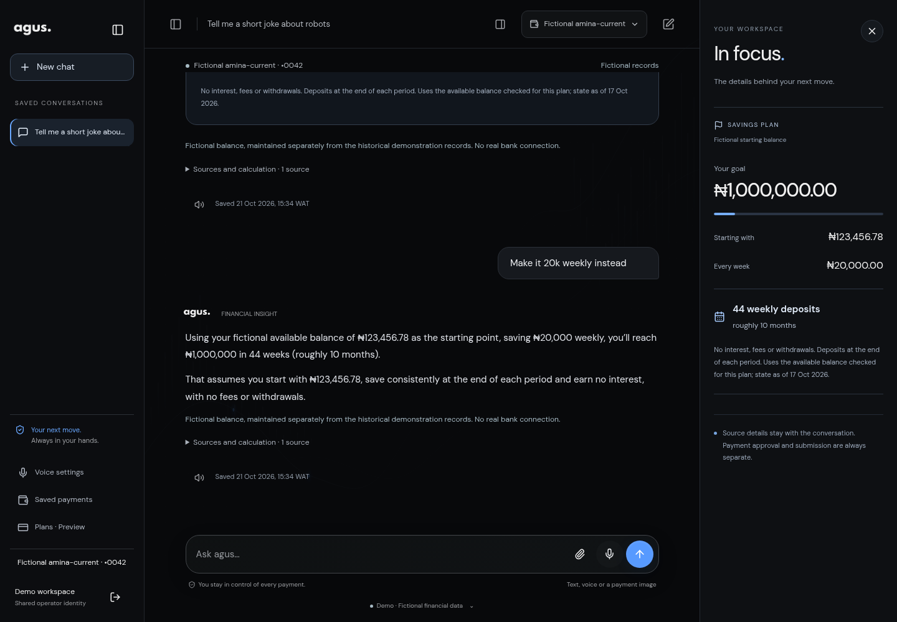
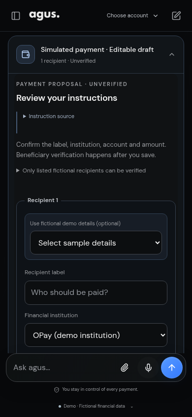
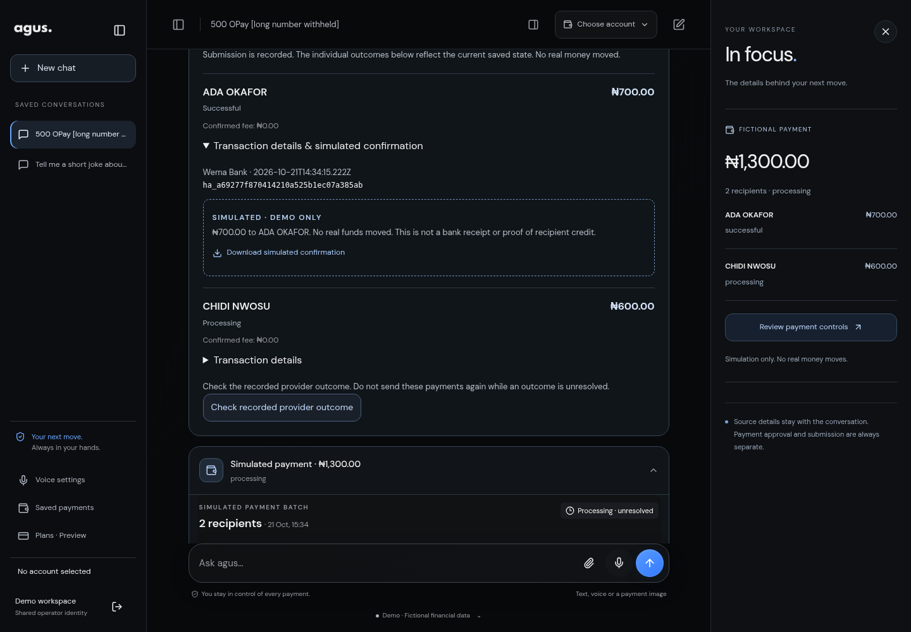

# Rendered AGUS evidence

Actual production-build application in a disposable fictional workspace. Model transport is scripted, banking/provider operations are simulated, and all financial details are synthetic. These are Chromium captures, not physical Android screenshots. Baseline images are committed artifacts from exact PR #42, not newly fetched production screenshots.

## Desktop before / after

| View          | Exact baseline                                                        | Current                                      |
| ------------- | --------------------------------------------------------------------- | -------------------------------------------- |
| Welcome       | [Baseline](../intelligence-motion/screenshots/1440-welcome.png)       | [Current](screenshots/1440-welcome.png)      |
| Conversation  | [Baseline](../intelligence-motion/screenshots/1440-conversation.png)  | [Current](screenshots/1440-conversation.png) |
| Account       | [Baseline](../intelligence-motion/screenshots/1440-account.png)       | [Current](screenshots/1440-account.png)      |
| Payment draft | [Baseline](../intelligence-motion/screenshots/1440-payment-draft.png) | [Current](screenshots/1440-image-drafts.png) |

The rail and optional In focus panel keep current supporting information beside the conversation. The figures derive from the authorized fictional source. [1920px conversation](screenshots/1920-conversation.png), [1280px savings](screenshots/1280-savings.png), [inline tablet plan](screenshots/820-savings.png).

## Instructions to outcomes

[Desktop bare amount](screenshots/1440-bare-amount-draft.png), [local image preview](screenshots/1440-image-preview.png), [multiple image drafts](screenshots/1440-image-drafts.png), [mobile image preview](screenshots/390-image-preview.png). Extracted fields require editing/review and fictional-provider verification.

[Initial processing without successful confirmation](screenshots/1440-payment-processing.png), [authoritative conversational status](screenshots/1440-payment-status.png), [mobile outcome](screenshots/390-payment-outcomes.png), [actual downloaded SIMULATED confirmation](screenshots/1440-simulated-confirmation.txt). The download is a plain AGUS demonstration file, not a bank receipt.

## Mobile and recovery

[320px focused composer at 420px simulated keyboard height](screenshots/320-keyboard-focus.png), [320px visual-only pan](screenshots/320-visual-viewport-pan.png), [390px short welcome](screenshots/390-welcome-short.png), [mobile navigation](screenshots/390-mobile-navigation.png), [account picker](screenshots/390-mobile-account.png), [interrupted image recovery](screenshots/390-image-interrupted.png). Physical keyboard/browser acceptance remains in REAL-DEVICE-CHECKLIST.md.

## Loading, interruption and motion

[Desktop generating](screenshots/premium-1440-generating.png), [mobile generating](screenshots/premium-390-generating.png), [interrupted response with retained draft](screenshots/premium-1440-network-error.png), [stopped response](screenshots/premium-390-stopped.png), [final compact 320px welcome](screenshots/premium-320-welcome.png), [processing state](screenshots/motion-390-processing.png), [welcome motion recording](screenshots/welcome-motion.mp4), [processing recording](screenshots/processing-motion.mp4). These are actual rendered states with deterministic transport and synthetic network failures. Frame-time p95 in this local run was 50.0/16.7/16.8/16.8 ms at 1440/820/390/320; the 390px sample used 4× CPU throttling. These are environment-specific observations, not a physical-phone performance claim.

The machine-readable workflow transcript, statuses, viewport counts and accessibility results are in [final-workflows.json](validation/final-workflows.json). All screenshots are app-rendered; no image-generation or mockup tool was used.
