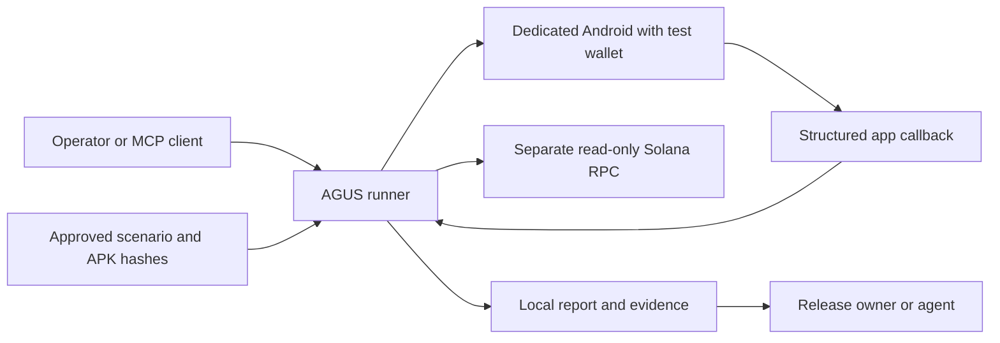

# Architecture and implementation checkpoints

## Executable path

1. The operator supplies an isolated device serial, approved packages, local APKs and hashes, test cluster and typed scenario. The runner stages each APK and verifies the bytes to be installed. It acquires an exclusive host lock and journals progression atomically.
2. The runner verifies genesis and records a chain slot before a wallet scenario. Android launch, UI waits, taps and screenshots use fixed local ADB commands. Approved test packages gate diagnostics. Scenario names are the only execution input accepted by MCP.
3. A timestamped event from the test dApp process reports rejection, handoff failure or a returned signature. The verifier requires finalized RPC signature status, consistent finalized transaction and slot, a fresh chain occurrence, exact payer/recipient/amount and observed balance changes. Optional scenario-pinned payer is preferred where the test account is known. The lab records when the payer came from the callback.
4. Reports preserve individual step states, screenshot and projected hierarchy filenames, callback and receipt. They record distinct failure categories for Android, wallet, RPC, chain finality and mismatch. Scope is one transaction per scenario. Unresolved finality requires reconciliation of the same signature before running a new payment.
5. The local settlement lab prepares a USDC-denominated quote, creates a six-decimal fixture SPL token on the dedicated validator, journals the exact signature before one broadcast and independently checks both token-account owners and deltas. Reopening the job directory reconciles the same signature. Production payments, jobs and escrow require separate implementation.
6. An external MCP client can start and poll a run. Its own model can reason over the structured report and operator-reviewed evidence. There are no model calls on the success path.

**Evidence scope.** `emulator` plus Fake Wallet indicates a real Android process and official test implementation of MWA with disposable local chain state. `android-device` means an explicitly configured physical Android runner without hardware provenance. Genuine Seeker evidence requires an authorized physical unit, pinned wallet and OS versions, app-link verification, attended approval, and hardware-specific evidence. A Seeker Genesis Token is an ownership signal tied to a wallet. It cannot establish which physical hardware ran a particular test. Separate device-provenance evidence is required.

## Integration boundaries

| Capability | Prototype and next acceptance condition |
| --- | --- |
| MWA | Native fixture uses official Android Java clientlib, including authorize and sign-and-send. A candidate APK needs a reviewed scenario and narrow instrumentation. |
| Seeker Connect | Keep separately versioned scenario family for generic fallback, direct endpoint, absent endpoint and auth cache behavior. A real Seeker/Seed Vault wallet run is required for the direct endpoint case on hardware. |
| Seed Vault | Build the official SDK simulator for a dedicated Android 12+ environment as a future wallet-contract baseline. Use an attended loaner for real key prompts. |
| Genesis Token and Seeker ID | For an optional provider eligibility flow, use fresh server nonce/domain-bound SIWS and verify wallet ownership through the official Genesis SDK. Treat the display .skr domain as identity metadata. Scope its public Mainnet lookups separately from payment and test execution. Omit until a real provider can participate. |
| dApp Store readiness | Inspect package, architecture, signature and configured App Links from the release. Offer an evidence export and an official publisher checklist. Local checks are narrower than store validation and human approval. [Publishing documentation](https://docs.solanamobile.com/dapp-publishing/intro) |
| Settlement | Local test SPL token demonstrated. Future Devnet demo requires Circle test USDC, funded disposable accounts, idempotent per-job intent, explicit review and exact finalized evidence. SKR is outside the MVP. |
| Hosted provider | A dedicated operator can currently run the same CLI on an isolated machine. A future hosted runner makes outbound authenticated connections, polls a single scoped lease and accepts a signed job manifest with package hashes. It can upload only bounded evidence over short-lived artifact grants. |

## Provider design for a later pilot

Use a dedicated test AVD or a resettable test handset per tenant, with device egress restricted to required test origins. The broker stores lease ID, provider ID, runner key, capabilities, APK hash, scenario hash, expiry and run ID. The device process accepts only a short list of approved test operations for that lease. It has no connection to the tenant’s control plane beyond its job grant.

Do not allow general endpoints for ADB, shell, device-wide logs, file browsing or clipboard. Capture on test accounts with production wallets and personal data absent. Review APKs before staging and use device reset or fresh snapshots between tenants. Genuine Seed Vault approvals should be attended, and approval evidence should omit secrets, PINs and biometrics. Device spoofing, provider dishonesty, and counterfeit chain data require attestation and independent corroboration before payments can rely on them.

## Implementation order

1. Preserve the signed financial application. Establish actual Android and chain execution with a negative control and rerun.
2. Ship a branch-only local scenario runner, CLI, stdio MCP, machine-readable reports, deterministic assertion tests and a local settlement demonstration.
3. Add one applicant APK wallet flow with a disposable identity, then pilot a generic Android hardware unit and an attended Seeker loaner. Compare with internal Maestro scripts using the same outcomes.
4. Add managed auth, isolated provider queue, artifact storage, Android shell and Devnet test-USDC job settlement only after pilot teams need them. Evaluate recurring pricing and vault-specific evidence before expanding provider supply.

## Prototype scope and physical infrastructure path

Broker selection now supports a small, operator-registered local pool. Device aliases are scoped to one runner. Discovery reports configured class, observed connectivity and lease state. Runs lease a compatible available device, record limited profile readings, and release the lease on terminal completion. No automated reassignment occurs after user or wallet interaction. Multi-host leases and consented everyday devices follow the dedicated test-device pilot.

The benchmark grades the agent's interpretation separately from the test outcome. Run latency and taps belong to the scripted scenario. The report signature binds approved build and evidence digests through a runner-controlled key. SAS, escrow, new Devnet transfers, comparative agent UI control and training exports are future proof points. [Physical device network design](NETWORK.md)
